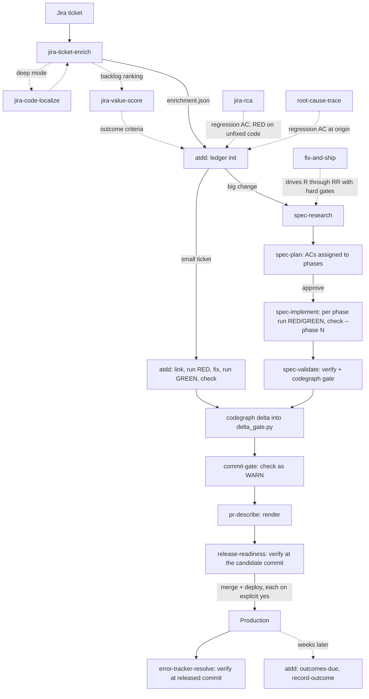

# Skills catalog

What you get here: the 19 skills in `skills/` in one table, the order they chain in, which skills write to the acceptance ledger and which only read it, and a decision list for the five places where two skills look alike. The step-by-step walkthrough is in [docs/GETTING-STARTED.md](docs/GETTING-STARTED.md).

Every skill treats ticket, log, and repo text as untrusted data and writes to Jira, GitHub, or a deploy target only after you approve the specific change in the conversation.

## Catalog

| Skill | What it does | Use it when | Hands off to |
|---|---|---|---|
| `jira-ticket-enrich` | Classifies a ticket (BUG / FEATURE / TASK / UNCLEAR), scores it against a Definition of Ready, rates severity and urgency, drafts reproduction steps and Given/When/Then criteria (a bug's first criterion is its regression), finds duplicates and linked PRs, proposes routing. Renders a Jira comment with an idempotency marker. | A ticket (or JQL batch) needs to be development-ready. "Enrich / triage / groom / refine PAY-482." | `atdd` (`init --from enrichment.json`), `jira-value-score`, `fix-and-ship`, `spec-plan` |
| `jira-code-localize` | Finds the files and line ranges most likely responsible for a ticket's symptom, with a hypothesis, complexity, risk, and owners; maps AC ids to code areas and existing tests when given them. Read-only, runs in a forked context. | Deep mode inside `jira-ticket-enrich`, or "where in the code does this ticket's problem live". | Returns a 25-line report to its caller |
| `jira-value-score` | Ranks tickets by value per unit of size against the team's success metrics; flags tickets that move no metric; drafts outcome criteria that become an instrumentation AC (blocking) and an outcome AC (post-release). Arithmetic is `scripts/score.py`. | "Prioritize the backlog", "what should we build next", WSJF-style ranking. | `jira-ticket-enrich`, `atdd` (`init --from` the value-score JSON), `outcomes-due` after release |
| `jira-rca` | Root-cause analysis for one defect ticket: impact scan, evidence from ticket, logs, PRs, and code, a hypothesis register with evidence for and against, confirming checks, fix options. Records the confirming failing test as a regression AC. Diagnoses only. | "Why did this bug happen", post-mortem on a ticket, what to ask the reporter. | `atdd` (regression AC, RED on unfixed code), `root-cause-trace`, a fix workflow |
| `root-cause-trace` | Follows one wrong value upstream with a written 10 Whys chain, names the origin layer, writes a failing test there as a regression AC, fixes at the source, removes downstream band-aids. | Wrong or null data in a UI, report, or API; a type mismatch; you're about to add a defensive default. | `atdd` ledger (regression AC), `commit-gate` |
| `jira-productivity` | Throughput, lead and cycle time, blocked share, work-type mix, PR review times from Jira and GitHub exports, compared across two periods; optional requirement churn from ledger revisions. Read-only, team-level. | "Why did delivery slow down", sprint health, review turnaround. | Report only |
| `codegraph` | Indexes a Python repo with `codegraph-slicer`; `map`, `slice`, `flow`, and a base-vs-head `delta` with `scripts/delta_gate.py` for untested changed symbols, forbidden imports, and new cycles. | Before reading many files of unfamiliar Python; "what calls this"; sizing a diff; the static test-gap gate. | `spec-research`, `spec-validate`, `release-readiness`, `fix-and-ship` |
| `atdd` | Turns criteria into Given/When/Then, surfaces gaps as questions, writes failing acceptance tests, records executed RED and GREEN with digests of criterion, test, harness, and command in `docs/specs/<id>/acceptance.json` via `scripts/acceptance_ledger.py`. `check` gates development; `verify` re-executes at the release commit; `revise` handles changed requirements; `outcomes-due` and `record-outcome` close post-release criteria. | Any ticket with requirements. Standalone on small tickets; driven by `spec-implement` on planned ones. | `spec-plan` (phase assignment), `spec-implement`, `spec-validate`, `commit-gate`, `pr-describe` (`render`), `release-readiness` and `error-tracker-resolve` (`verify`) |
| `spec-research` | Answers "how does X work here" with `path:line` citations, maps each AC to code and existing tests, writes `docs/specs/research/<date>-<slug>.md`. Read-only. | Before planning a change in an area you don't know. | `spec-plan` |
| `spec-plan` | Phased plan with current-state analysis, out-of-scope list, runnable success criteria per phase, rollback, every AC assigned to a phase in the ledger; new ACs get a fixed kind; outcome ACs go in a post-release section. Hard stop for approval. | Any change too big to hold in your head; a ticket that needs design decisions. | `spec-implement` (after `status: approved`) |
| `spec-implement` | Executes an approved plan one phase at a time: baseline, acceptance test, `run` RED, implement, `run` GREEN, refactor, `check --phase N`, tick boxes. Stops on divergence. | "Implement phase 2 of the plan", resume a half-done plan. | `spec-validate` |
| `spec-validate` | Independently re-runs every success criterion and every AC, then `verify` at the candidate commit and the codegraph gate; compares code to plan; verdict PASS / PASS WITH NOTES / FAIL in `docs/specs/validation/`. | After the last phase, before asking for review. | `release-readiness`, back to `spec-implement` for fixes |
| `commit-gate` | Detects the repo's formatter, linter, type checker, and tests (`scripts/detect_tools.py`), runs the fast subset on changed files, runs ledger `check` as a WARN on commit (stale or tampered evidence included). | Before every commit; setting up a hook. | `pr-describe` |
| `pr-describe` | Fills the repo's PR template from the real diff and commits, runs the verification commands, ticks only what passed, embeds the ledger traceability matrix and calls out stale, tampered, or legacy rows, updates via `gh pr edit`. | After implementation, before asking for review. | `release-readiness` |
| `release-readiness` | Go/no-go against production: build, type check, full tests, config and flag diff, error-tracker regressions, ledger `verify` at the release candidate and codegraph gate as BLOCKING. Never deploys. | Before merge or deploy; "is this ready". | You decide; `fix-and-ship` reads the verdict |
| `fix-and-ship` | Orchestrates research -> plan -> approval -> test-first implementation (`check` before review) -> validate and security pass -> pre-deploy gates -> `verify` and codegraph gate on the merge candidate -> PR -> merge (ask) -> deploy (ask) -> smoke check. Resolves deploy config per repo in Phase 0. | "Ship this fix", "take PAY-490 to prod". | `error-tracker-resolve` after the smoke check |
| `error-tracker-resolve` | Finds the tracker issue, confirms the PR touches the stack-trace code, requires the regression AC to pass `verify` at the released commit, prefers resolve-in-next-release, then resolves / ignores / reopens via `scripts/resolve.py` after approval. | After a fix is serving. | Done |
| `codebase-health` | 1-5 scorecard across coverage, complexity, tech-debt signals, dependencies, hygiene, with `scripts/health_scan.py` for deterministic counts; reports the requirement-weld signal (share of ledgers passing `check`, stale criteria, overdue outcomes). Read-only. | Quarterly audit, "what needs cleanup", onboarding to a repo. | `spec-plan` for the action items |
| `zoom-out` | Five-level synthesis (Evidence, Pattern, Situation, Implication, Context) over a repo, docs folder, or ticket set, with every level citing the one below. No ledger touchpoint, by design. | "Where does this project stand", "is this conclusion supported". | A decision |

## How they chain

Dotted edges are optional or conditional. `codebase-health`, `jira-productivity`, and `zoom-out` sit outside the delivery chain; they feed decisions about what to work on.

## How the weld works

Every skill except `zoom-out` touches `docs/specs/<id>/acceptance.json`, and only through `acceptance_ledger.py`. The point of routing everything through one file is that no skill can mark a requirement done by saying so: a criterion enters the ledger once, with a fixed kind, and leaves the gate only through an executed RED, an unchanged test and harness, an executed GREEN, and a re-execution at the commit being shipped.

| Skill | Writes to the ledger | Reads from the ledger |
|---|---|---|
| `jira-ticket-enrich` | Indirectly: produces the `enrichment.json` that `init --from` consumes (BUG -> first AC is `regression`) | no |
| `jira-value-score` | Indirectly: produces the value-score JSON whose `outcome_criteria` become an instrumentation AC and an outcome AC via `init --from` | no |
| `jira-code-localize` | no | AC ids passed by the caller, mapped to code areas and tests |
| `jira-rca` | `add --kind regression`, `run` (must be RED on unfixed code) | no |
| `root-cause-trace` | `add --kind regression`, `run` at the origin | no |
| `atdd` | `init`, `add`, `link`, `revise`, `run`, `record-outcome` | `check`, `verify`, `render`, `outcomes-due`, `codegraph-args` |
| `spec-research` | no | the AC list, to map each to code and existing tests |
| `spec-plan` | `link --phase`, `add --phase --kind` | `render` (no blocking row may lack a phase) |
| `spec-implement` | `link`, `run` per AC per phase | `check --phase N` before the next phase |
| `spec-validate` | `run` (re-executes every AC), `verify` (records its runs) | `verify` result, `render`, `codegraph-args` |
| `codegraph` | no | `codegraph-args` output feeds `delta --selected-test` |
| `commit-gate` | no | `check` (WARN on commit, BLOCK on push or release) |
| `pr-describe` | no | `render`, flags stale, tampered, or legacy rows |
| `release-readiness` | `verify` (records its runs) | `verify` result (BLOCKING), `codegraph-args` |
| `fix-and-ship` | through `atdd`, `spec-implement`, `verify` | `check` before review, `verify` on the merge candidate |
| `error-tracker-resolve` | `verify` at the released commit (records its runs) | `verify` result; asks before resolving if no ledger exists |
| `codebase-health` | no | `check` per ledger, stale counts, `outcomes-due --all` |
| `jira-productivity` | no | `revisions` per criterion, for requirement churn |
| `zoom-out` | no | no |

`check` reads stored evidence and is the development-time gate. `verify` re-executes and is the release gate. `revise` is the only sanctioned way to change a criterion, and it resets that criterion's evidence. Nothing deletes an AC. Mechanics and limits: [docs/ATDD-AND-CODEGRAPH.md](docs/ATDD-AND-CODEGRAPH.md).

## Which skill do I use?

### commit-gate vs release-readiness vs spec-validate

They answer different questions about the same diff.

- **commit-gate**: "Can I commit this?" Fast subset (format, lint, types, unit tests on changed files), seconds to a couple of minutes, ledger `check` is a warning. Run it constantly.
- **spec-validate**: "Did I build what the plan said?" Re-runs every success criterion and every AC, runs `verify` at the candidate commit, compares code to plan, flags out-of-scope changes. Only meaningful when there's a plan. Run once after the last phase.
- **release-readiness**: "Is this safe against production?" Full suite, type check, config and flag diff against prod, error-tracker regressions, ledger `verify` and codegraph gate as BLOCKING. Run before merge or deploy, with or without a plan.

A small ticket uses commit-gate and release-readiness and skips spec-validate.

### jira-rca vs root-cause-trace

- **jira-rca** starts from a ticket and doesn't yet know the cause. It builds a hypothesis register from logs, PRs, and code, picks a confirming check per hypothesis, and stops at a confirmed or likely cause with fix options. For a code defect the confirmation is a failing test recorded as a regression AC. It never edits production code.
- **root-cause-trace** starts from a known wrong value and follows it upstream to the layer where it first went wrong, records the failing test at that origin as a regression AC, then fixes there and deletes the downstream patches.

Use jira-rca when the question is "why did this happen"; use root-cause-trace when the question is "where does this wrong value come from" or when you catch yourself adding a null filter. jira-rca often ends by handing the leading hypothesis to root-cause-trace, and the regression AC carries across.

### atdd vs spec-implement

Same ledger, different scope.

- **atdd** owns the discipline: derive criteria, ask the gap questions, write the failing test, `run` RED, implement, `run` GREEN, `check`, `revise` when the requirement moves. On a small ticket it's the whole workflow.
- **spec-implement** runs an approved plan phase by phase and calls the ledger for each AC the phase lists, adding the plan's own gates (baseline, success-criteria commands, full suite per phase, divergence protocol).

If there's no plan, use atdd. If there's an approved plan, use spec-implement; it uses atdd's ledger underneath.

### jira-ticket-enrich vs jira-value-score

- **jira-ticket-enrich** asks "is this ticket ready to work on, and what's it about?" Readiness, type, severity and urgency, reproduction, acceptance criteria, routing. Priority is a suggestion with a decision path.
- **jira-value-score** asks "which of these should we do first?" Value per metric with quoted evidence, divided by size band, ranked. It won't touch readiness, but it does add two kinds of criteria the enrichment can't: the instrumentation that proves a metric is measurable, and the post-release outcome.

Enrich first; score when you have a set to rank. jira-value-score reuses `impact` and `size_signals` from enrichment JSON when present.

### codegraph vs spec-research vs jira-code-localize

All three find code. They differ in what they produce and what they cost.

- **codegraph** is a tool, not a document: bounded `map` and `slice` output under a token budget, plus the `delta` gate. Python only, static only. Use it inside the other two, or directly for "what calls this" and "size this diff".
- **jira-code-localize** answers one narrow question, "where is this ticket's problem", in a forked context so the file reads stay out of your conversation. Returns a ranked list of `path:start-end` with a hypothesis and owners, 25 lines max, and maps AC ids to code when given them. It uses codegraph when available.
- **spec-research** produces a reusable findings document with `path:line` citations, an AC-to-code map, and open questions, meant to be the input to `spec-plan`. Heavier; worth it when the change is big or the area is unfamiliar.

For a bug in a known module: codegraph `slice` or nothing. For an enrichment: jira-code-localize. For a plan: spec-research.
